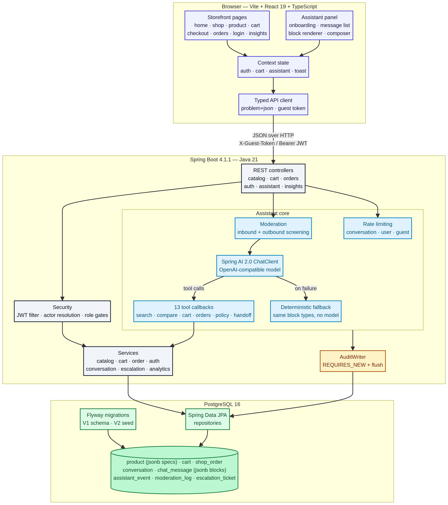

# Shopwise

An e-commerce storefront with an embedded **AI shopping assistant** that helps a shopper go from
"I need a laptop under $1,500" to a confident decision — and then to a completed checkout — without
leaving the conversation.

| Layer | Technology |
| --- | --- |
| Frontend | Vite 8 · React 19 · TypeScript 5.9 · React Router 7 |
| Backend | Java 21 · Spring Boot 4.1.1 · Maven |
| Assistant | Spring AI 2.0.0 (`spring-ai-starter-model-openai`) with tool calling |
| Database | PostgreSQL 16 (Flyway migrations) |
| API style | RESTful JSON, RFC 9457 problem documents, OpenAPI 3 |
| Auth | BCrypt + JWT bearer tokens, role gates for staff areas |

---

## What it does

**Storefront.** A catalogue of 24 products across six categories with faceted search
(category, price band, availability, free text, six sort orders), product detail pages with full
spec sheets, a guest-friendly cart with stock guards and shipping thresholds, a demo checkout, and
order tracking that distinguishes signed-in shoppers from guests.

**Recommendations.** Rails built from what shoppers actually did, not from a hand-written list.

- **Personalised** — a "Recommended for you" rail on the home page, driven by the shopper's own
  browsing with a two-week half-life, for guests as well as signed-in users.
- **Bought together** — what people genuinely buy with a product, quoted as a share of buyers
  ("55% of buyers also bought this"), computed from purchases alone rather than browsing.
- **Similar** — comparable alternatives that prefer the same category and fall back to attributes for
  a product nobody has bought yet.
- **Basket cross-sell** — "complete your order" suggestions that follow the basket and update when it
  changes.
- **Every recommendation explains itself** — each product carries the reason it was chosen, and a rail
  that could not personalise says so instead of pretending.
- **Measured** — impressions are counted only when a rail is actually scrolled into view, clicks are
  attributed to the rail that produced them, and click-through per placement is on the staff dashboard.

**Assistant.** A conversational layer that is useful for the three things shoppers actually do:
find something, compare options, and check on an order.

- **Onboarding** — a welcome that names the assistant's real capabilities, lists all 14 supported
  intents with a *sample utterance* and a *typical answer* for each, and states its limits up front.
- **Tool-grounded answers** — the model never invents products. Every claim comes from a tool call
  against the live catalogue: `search_products`, `get_product_details`, `compare_products`,
  `find_best_value`, `recommend_products`, `list_categories`, cart operations, order lookup and store
  policy.
- **Recommends from behaviour** — asked what goes with a product, it uses the same recommendation
  engine as the storefront rails and passes on the reason, so a conversation and a product page never
  disagree. When there is not enough history to support a claim, it says so and searches instead.
- **Context-aware follow-ups** — "which one should I buy?" resolves against the two products it just
  compared, because the assistant replays the recent transcript into the model on every turn.
- **Actions, not just answers** — it can add to the cart, change quantities, remove items and raise a
  support ticket, with the UI reflecting the result immediately.
- **Rich rendering** — product cards, a spec comparison table with the differing rows highlighted,
  cart summaries, order cards with a delivery timeline, and inline notices.
- **Guardrails** — prompt injection, card numbers, self-harm language and spam are screened before the
  model sees them; the model's own draft is screened before the shopper sees it.
- **Graceful degradation** — if the model is unreachable, the assistant answers from the catalogue
  with deterministic rules, tells the shopper it is doing so, and keeps every tool-equivalent action
  available.
- **Human escalation** — one button raises a ticket with the transcript attached, pauses the bot for
  that conversation, and lets the shopper hand it back with `/resume`.
- **Usage analytics** — resolution, fallback, escalation, moderation and satisfaction rates, top
  intents and tools, a daily volume chart and the live escalation queue, behind a `SUPPORT`/`ADMIN`
  gate.

---

## Quick start

### Prerequisites

Java 21+, Maven 3.9+, Node 20+, PostgreSQL 16+.

### 1. Database

```bash
sudo service postgresql start
sudo -u postgres psql -c "CREATE USER shopwise WITH PASSWORD 'shopwise';"
sudo -u postgres psql -c "CREATE DATABASE shopwise OWNER shopwise;"
```

Flyway creates the schema and seeds the catalogue on first boot — there is no manual SQL step.

### 2. Backend

```bash
cd backend
export OPENAI_API_KEY=sk-...            # any OpenAI-compatible key
export OPENAI_BASE_URL=https://api.openai.com   # optional, defaults to OpenAI
mvn spring-boot:run
```

Serves `http://localhost:8080`. Swagger UI: `http://localhost:8080/swagger-ui.html`.

Connection settings live in `backend/src/main/resources/application.yml` and can be overridden with
environment variables:

| Variable | Default | Purpose |
| --- | --- | --- |
| `SHOPWISE_DB_URL` | `jdbc:postgresql://localhost:5432/shopwise` | JDBC URL |
| `SHOPWISE_DB_USER` / `SHOPWISE_DB_PASSWORD` | `shopwise` / `shopwise` | Credentials |
| `SHOPWISE_JWT_SECRET` | dev-only default | **Change in any real deployment** |
| `OPENAI_API_KEY` / `OPENAI_BASE_URL` | — | Model access |
| `SHOPWISE_MODEL` | `gpt-5-mini` | Model name |

### 3. Frontend

```bash
cd frontend
npm install
npm run dev      # http://localhost:5173, proxies /api to localhost:8080
```

For a production build: `npm run build && npm run preview` (serves on 4173 with the same proxy).

### 4. Demo accounts

Seeded by `V2__seed.sql`:

| Role | Email | Password | What it unlocks |
| --- | --- | --- | --- |
| CUSTOMER | `customer@shopwise.dev` | `Password123!` | Order history, saved carts |
| SUPPORT | `agent@shopwise.dev` | `Support123!` | Assistant insights + escalation queue |
| ADMIN | `admin@shopwise.dev` | `Admin123!` | Everything |

Guests are first-class: the storefront generates a stable `X-Guest-Token` so carts and conversations
survive a reload, and it is merged into the account on sign-in.

---

## Project layout

```
shopwise/
├── backend/                      Spring Boot service
│   └── src/main/java/com/shopwise/
│       ├── ai/                   assistant: prompt, tools, intents, moderation, runtime
│       ├── config/               security, OpenAPI, typed properties, AI wiring
│       ├── domain/               JPA entities
│       ├── repository/           Spring Data repositories
│       ├── security/             JWT service, filter, actor resolution
│       ├── service/              catalogue, cart, orders, auth, conversations, analytics
│       └── web/                  controllers, DTOs, mappers
├── frontend/                     Vite + React storefront
│   └── src/
│       ├── components/           shell, product cards, states, cart drawer
│       │   └── assistant/        panel, onboarding, message list, block renderer
│       ├── lib/                  typed API client, formatting
│       ├── pages/                home, shop, product, cart, checkout, orders, login, insights
│       ├── state/                auth, cart, assistant, toast contexts
│       └── styles/app.css        design system
├── docs/                         API contract, architecture, assistant design, runbook
├── scripts/                      smoke test, media generator, screenshot capture
└── artifacts/                    screenshots and generated diagrams
```

---

## Documentation

| Document | Contents |
| --- | --- |
| [docs/API.md](docs/API.md) | Every endpoint, payload, status code and error shape |
| [docs/ARCHITECTURE.md](docs/ARCHITECTURE.md) | Component diagram, request lifecycle, data model |
| [docs/ASSISTANT.md](docs/ASSISTANT.md) | Assistant design: intents, tools, guardrails, fallbacks, analytics |
| [docs/RUNBOOK.md](docs/RUNBOOK.md) | Run, test, verify and troubleshoot |



Diagram sources: [`artifacts/architecture.mmd`](artifacts/architecture.mmd) (Mermaid) and
[`artifacts/architecture.d2`](artifacts/architecture.d2) (D2).

---

## Testing

```bash
# End-to-end API suite: catalogue, cart, checkout, auth, assistant tool loop,
# moderation, escalation, recommendations, analytics, OpenAPI
python3 scripts/smoke-test.py http://localhost:8080

# Drive one realistic shopper conversation through the assistant and check what each turn
# actually did, reading the tool calls back from the audit log rather than trusting the reply
python3 scripts/assistant-reco-scenario.py http://localhost:8080

# Regenerate branded product artwork from the seeded catalogue
python3 scripts/generate-product-media.py

# Drive the UI in a headless browser and capture screenshots
python3 scripts/capture-screens.py http://localhost:4173 artifacts/screenshots

# Verify the deployment's own hostname is accepted as an origin (every mutating request is a
# POST, and a browser sends Origin on those, so a missing allow-list entry breaks the whole app
SHOPWISE_TEST_ORIGIN=https://your-host.example.com python3 scripts/smoke-test.py http://localhost:8080

# Gate a push on credential detection
python3 scripts/secret-scan.py            # working tree
python3 scripts/secret-scan.py --staged   # staged files only, for a pre-push hook
```

Latest results in this environment:

| Suite | Result |
| --- | --- |
| `scripts/smoke-test.py` (API, end to end) | **95 / 95 passing** |
| `scripts/assistant-reco-scenario.py` (8-turn shopper conversation) | **28 / 28 passing** |
| `npx tsc -b && npm run build` | Clean, no type errors |
| `scripts/capture-screens.py` (24 UI screens, desktop + mobile) | 24 / 24 captured, **0 console errors** |

The scenario script is the more interesting of the two. It runs a shopper from a cold start to a
deliberate prompt injection, and after every turn it reads which tools fired out of the
`assistant_event` audit log. A turn that merely *sounds* like it used `recommend_products` fails if
it did not call it, which is how the defects listed in
[`docs/ASSISTANT.md`](docs/ASSISTANT.md#12-what-testing-the-recommendation-tool-found) were found.

### Screenshots

Captured from the running stack into `artifacts/screenshots/`:

| File | Screen |
| --- | --- |
| `01-home.png` | Storefront home with the assistant entry point |
| `02-shop.png`, `03-shop-empty-state.png` | Faceted search, and the genuine no-results state |
| `04-product-detail.png` | Product page with the full spec sheet |
| `05-assistant-onboarding.png`, `06-assistant-intents.png` | Welcome flow and the expanded intent catalogue |
| `07-assistant-comparison.png` | Side-by-side spec table with differences marked |
| `08-assistant-budget-search.png` | Budget search results rendered as product cards |
| `09-assistant-cart-action.png` | The assistant acting on the cart |
| `10-assistant-moderation.png` | Prompt injection refused before reaching the model |
| `11-cart.png`, `12-checkout.png` | Cart and checkout with validation |
| `13-login.png`, `14-insights-gate.png` | Sign-in, and the permission screen for non-staff |
| `15-insights-staff.png` | Assistant analytics and the escalation queue |
| `16-orders.png` | Order tracking and history |
| `17-mobile-home.png`, `18-mobile-assistant.png` | Mobile layouts |
| `19-reco-home-cold-start.png` | Recommendations for a new visitor: a labelled popularity fallback, not a fake personalisation |
| `20-reco-home-personalised.png` | The same rail after browsing — every card states why it is there |
| `21-reco-product-detail.png` | "Frequently bought together" with real co-purchase shares, and "similar" staying in category |
| `22-reco-cart-cross-sell.png` | Basket cross-sell following what is in the cart |
| `23-assistant-recommendations.png` | The assistant answering "what do people buy with the Aurora Book Pro 14", with the rail's reasons and the tool chips showing `recommend_products` ran |
| `24-assistant-recommendation-refusal.png` | The same question about a product with no co-purchase history: the tool refuses and says why |
| `25-assistant-starter-fixed.png` | A conversation starter answered end to end after the CORS fix, with the tool chips that show which tools ran |

---

## Design decisions worth knowing

0. **Secrets never live in the repository.** Configuration reads every credential from an
   environment variable with a documented local fallback (see `.env.example`), and
   `SecurityStartupCheck` refuses to boot with the development JWT signing key once a non-local
   profile is active — a clone that reaches production without overriding it fails loudly instead
   of accepting forgeable sessions. `scripts/secret-scan.py` blocks a push that would add a real
   credential, and its inline allowlist keeps the seeded demo accounts as a conscious exception
   rather than a blanket ignore.

1. **The assistant loop is not one transaction.** Conversation, cart and audit writes commit
   independently, so a failure while recording analytics can never roll back what the shopper just
   did. Audit rows use their own `REQUIRES_NEW` transaction with an explicit flush.
2. **The model is never trusted for facts.** Prices, stock and specifications only ever come from
   tool results against the database. The system prompt states that tool output is authoritative.
3. **Deterministic pre-parsing feeds the model.** A rule-based classifier extracts budget, category,
   SKUs and order references from the message and passes them to the model as explicit signals, which
   measurably improves tool arguments.
4. **Explicit JSON mapping over reflection.** Stored message blocks are converted to and from view
   records by hand, so a change to a view type can never silently change what is persisted, and the
   domain layer keeps no dependency on view types.
5. **Degradation is a feature.** Every dependency has a fallback path, and the UI always says which
   mode it is in rather than pretending.

## Running it

### With Docker (fastest)

Three containers — PostgreSQL, the Spring Boot API and an nginx image serving the storefront — with
the database migrated and seeded on first boot.

```bash
cp .env.example .env
openssl rand -base64 48          # paste into SHOPWISE_JWT_SECRET
docker compose up -d --build
```

Open **http://localhost:8080**. Only the frontend publishes a port; the API is reached through the
nginx reverse proxy. Full details, including TLS, backups and troubleshooting, are in
[docs/DEPLOYMENT.md](docs/DEPLOYMENT.md).

To put it on a host that stays up — with auto-start after a reboot, a domain and HTTPS — run
`./scripts/deploy-persistent.sh` on that host and follow
[A permanent deployment](docs/DEPLOYMENT.md#a-permanent-deployment).

### From source

For development: Java 21+, Maven 3.9+, Node 20+ and PostgreSQL 16+, as laid out under
[Quick start](#quick-start). The API runs with `mvn spring-boot:run` and the storefront with
`npm run dev`, whose proxy to the API is configured in `vite.config.ts`. Flyway migrates and seeds
the database on first boot, so there is no manual SQL step.

```bash
python3 scripts/smoke-test.py http://localhost:8080     # 95 checks across the whole API
```
