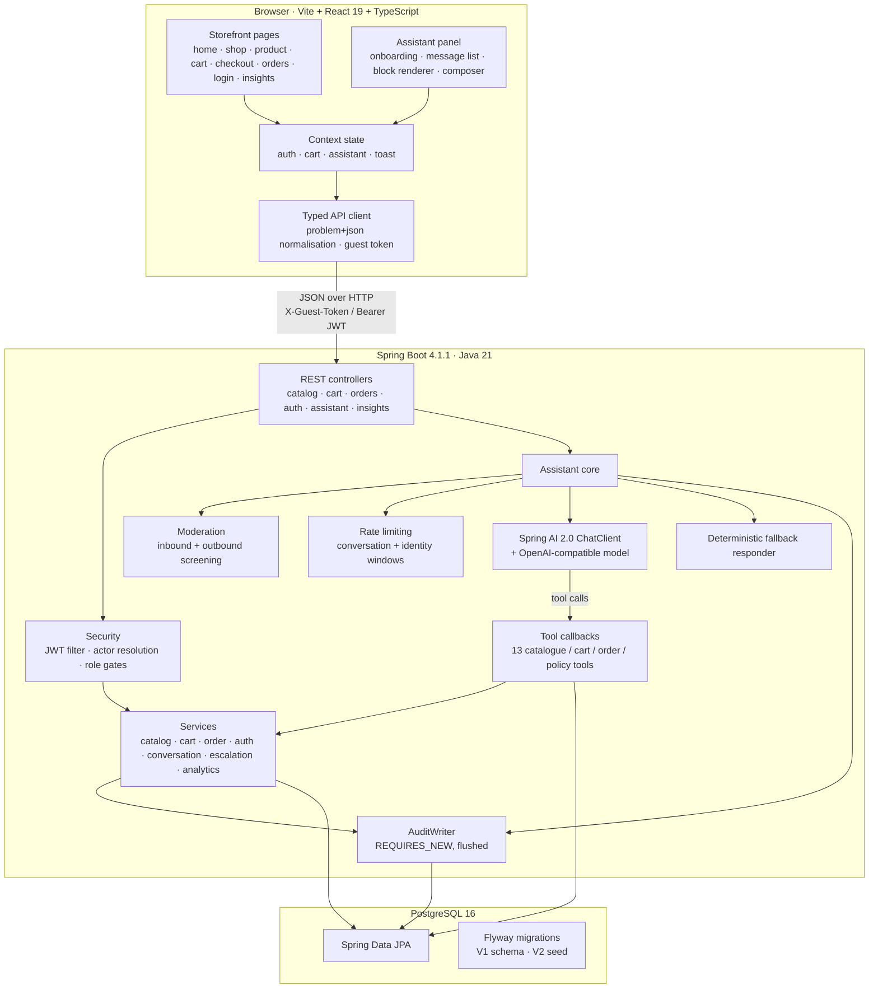
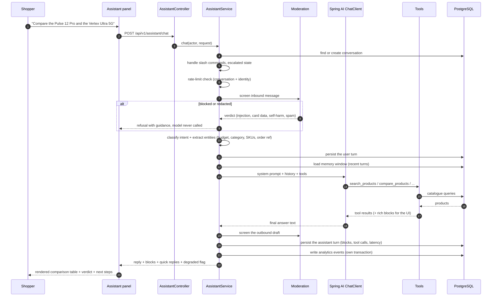
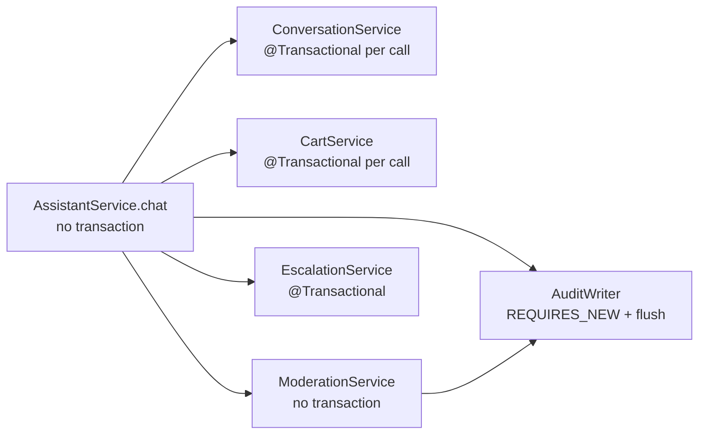
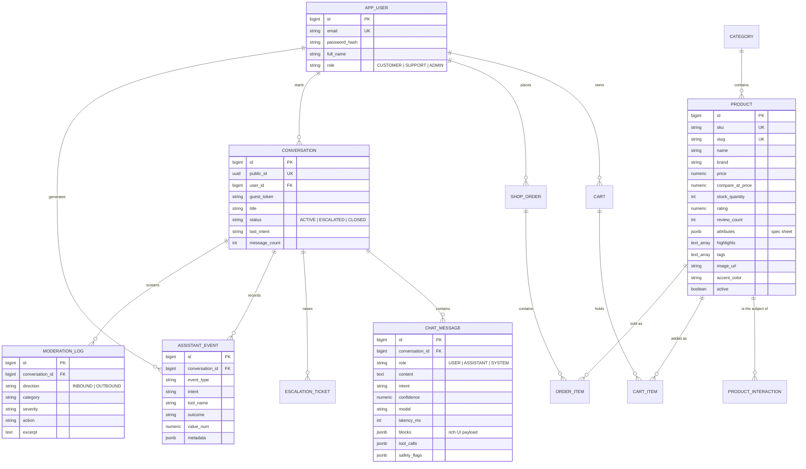
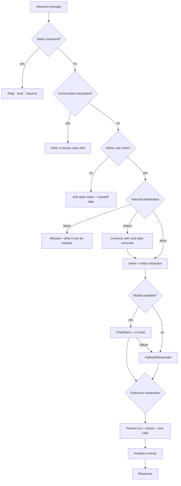

# Architecture

## System overview



## Request lifecycle: one assistant turn

This is the part worth understanding, because the ordering is deliberate.



### Why it is ordered this way

| Step | Reason |
| --- | --- |
| Commands before moderation | `/help`, `/end` and `/resume` are UI control, not shopper prose. |
| Escalated check before the model | Once a human owns the conversation, the bot must not talk over them. |
| Rate limit before moderation | Cheap, and stops a runaway client from filling the moderation log. |
| Moderation before persistence | Blocked content is logged in `moderation_log` with a redacted excerpt, never replayed into the model's memory. |
| Classification before the model call | The extracted budget/category/SKUs are injected into the system prompt as explicit signals, which makes the model's tool arguments far more reliable. |
| Outbound screening after the model | Stops the assistant echoing card numbers or leaking its instructions. |
| Analytics last, in its own transaction | A failed insert must never roll back the shopper's turn. |

## Transaction boundaries

The assistant loop is **not** wrapped in a single transaction, which is unusual and intentional.



- Each unit of work commits on its own, so a failure recording analytics cannot undo a cart change or
  a saved message.
- `AuditWriter` uses `REQUIRES_NEW` **and an explicit flush**, so a database problem surfaces as a
  catchable exception inside the method rather than as a commit-time `UnexpectedRollbackException`
  escaping the caller.
- `ConversationService` reloads the managed row before every mutation and copies the result back onto
  the caller's detached instance. Without this, a stale in-memory conversation would overwrite the
  `ESCALATED` status set moments earlier by a tool.

## Data model



Notes:

- **`product.attributes` is JSONB** — a flexible spec sheet is what makes cross-product comparison
  possible without a table per category.
- **`conversation.public_id` is a UUID** exposed to clients; the numeric primary key never leaves the
  server. This is what ownership checks key on.
- **`chat_message.blocks` stores the rich UI payload** as it was rendered, so a transcript replays
  identically after a reload.
- **`assistant_event` is append-only** and indexed on `(event_type, created_at)`,
  `(intent)`, `(tool_name)` and `(conversation_id)`, which is what makes the analytics queries cheap.
- **`product_interaction` is append-only and denormalised on purpose.** `actor_key` holds
  `user:<id>` or `guest:<token>` as text rather than a foreign key, because guest browsing has no user
  row to point at and anonymous visits are most of the traffic. `weight` is stored rather than derived
  so the aggregation queries stay plain sums, with the enum remaining the source of truth for the
  values. `recommendation_id` groups one rail's impressions with the clicks that followed, which is
  what makes click-through measurable per placement rather than per product.

## Recommendation engine

Rails are built from two signals that fail in opposite directions, which is why both are kept.

| | Collaborative | Content |
| --- | --- | --- |
| **Source** | The interaction log | Category, brand, price, spec tokens |
| **Strength** | Captures relationships nobody wrote down | Works for a product with no history at all |
| **Weakness** | Useless for a new product | Only knows what was already recorded about it |

A pair is scored by behaviour where behaviour exists and by attributes where it does not. The blend is
weighted by the *weaker* of the two products' confidence, where confidence is interaction count
against a saturation point. So a pair of well-understood products is described by what shoppers did,
and a pair involving a cold product falls back to what the products are. Without that, a new arrival
is either invisible or recommended on the basis of two accidental clicks.

```
        interaction log                    product table
   (views, carts, purchases)        (category, brand, price, specs)
              │                                  │
              ▼                                  ▼
     item-item cosine over              weighted attribute
     co-occurrence (per actor)          similarity per pair
              │                                  │
              └──────────────┬───────────────────┘
                             ▼
                  blended similarity
        (trust = min(confidence_a, confidence_b))
                             │
        ┌────────────────────┼────────────────────┐
        ▼                    ▼                    ▼
  neighbours()        personalised        purchase affinity
  similar / trending  for-you             also-bought / cart
                             │
                             ▼
                   greedy MMR diversity pass
              (focused λ for similar/bought rails,
               broad λ for for-you and trending)
                             │
                             ▼
                  products + reason per item
```

**Purchase affinity is computed separately** from general co-occurrence. "People who looked at this
also looked at that" is a browsing claim; "people who bought this also bought that" needs both items
to have left the shop together. It is expressed as the share of the less popular item's buyers who
took both, which makes the number symmetric and worth printing in the UI.

**Diversity is applied after ranking, not instead of it.** Greedy maximal marginal relevance subtracts
a penalty for similarity to what has already been selected. The weight differs by rail: a "similar to
this" rail must stay on topic, so its penalty is small, while a home-page rail benefits from breadth.

**Every recommendation carries a reason**, generated from whichever signal actually drove it. A rail
that cannot explain itself cannot be debugged, and a shopper cannot judge whether to trust it.

### The interaction log

One append-only table, `product_interaction`, with a `weight` per interaction type and an `actor_key`
of `user:<id>` or `guest:<token>`. Keeping guests in the same column means anonymous browsing still
contributes to co-occurrence, which matters because most first visits are anonymous.

Two rules govern how it is written:

- **The server records behaviour; the browser records attention.** Views, cart adds and purchases are
  written by the services that handle them, because the server is the only party that knows they
  happened. Impressions and clicks come from the browser, because only the browser knows what was on
  screen. `POST /recommendations/events` rejects behavioural types outright, so a crafted request
  cannot inflate the signal that drives everyone else's recommendations.
- **Telemetry never breaks a request.** Each write runs in its own `REQUIRES_NEW` transaction and
  failures are logged, not propagated. A recommendation system that can fail a checkout is worse than
  no recommendation system.

The model is rebuilt lazily and cached, with the cache keyed on a TTL. The full pairwise computation
is trivial at this catalogue size; a larger one would move the same computation into a scheduled job
writing a similarity table, without changing any of the call sites.

## Assistant internals



### Tool surface

| Tool | Purpose | Writes |
| --- | --- | --- |
| `search_products` | Catalogue search with budget, category and availability filters | no |
| `get_product_details` | Full spec sheet by SKU or slug | no |
| `compare_products` | 2–4 products, spec rows with differences marked, pricing verdict | no |
| `find_best_value` | Ranks options against a stated budget and use case | no |
| `recommend_products` | Similar, bought-together, personalised or trending rails, each item with its reason | no |
| `list_categories` | Categories with counts and entry prices | no |
| `get_cart` | Current cart with totals and shipping progress | no |
| `add_to_cart` | Adds a product, clamping to stock | yes |
| `update_cart_quantity` | Sets an absolute quantity | yes |
| `remove_from_cart` | Removes a line | yes |
| `get_order_status` | Order lookup honouring ownership and guest email rules | no |
| `list_recent_orders` | Signed-in order history | no |
| `get_store_policy` | Shipping, returns, warranty, payment, support answers | no |
| `request_human_handoff` | Raises an escalation ticket with the transcript | yes |

Every tool reports back through a shared `AssistantToolContext`, which carries the caller's identity,
the conversation, a sink for rich blocks and a log of tool names. The model gets structured results;
the shopper gets rendered components — from the same call.

### Failure handling

| Failure | Behaviour |
| --- | --- |
| Model unreachable or erroring | Three consecutive failures open a circuit breaker for five minutes; the assistant answers from catalogue rules and the UI shows a "limited mode" banner. |
| Tool throws | The tool returns a structured `{ "error": …, "message": … }` describing what to tell the shopper; the model recovers in the same turn. |
| Network failure in the browser | The failed turn is marked in the transcript with the original text retained, and a one-tap **Retry** plus a **Get a human** escape hatch. |
| Rate limit hit | A specific message with the retry window, not a generic error. |
| Conversation owned by someone else | `403`, with no detail leaked about the other conversation. |
